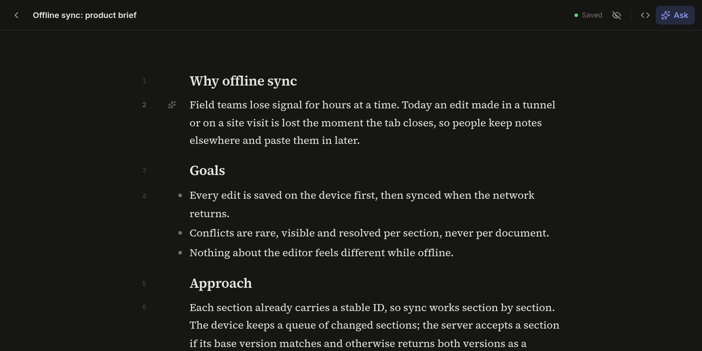

# Auto Report

Write reports with AI one section at a time. Every paragraph, heading and list
is a numbered section you can point the AI at ("shorten section 4", "merge 2
to 5"), and every change it makes arrives as a tracked suggestion you accept
or reject.

Two kinds of model share the work, because deciding what to do and writing
the text are different jobs:

- **Jev** (TypeSafe's decision model) reads your instruction and a short
  outline of the report, never the full text, and returns typed answers: what
  kind of edit, which sections, and how big a model it needs. It is fast and
  cheap, and its confidence scores let the app ask "Which section?" instead of
  guessing.
- **Claude** writes the change. **Haiku 5.5** handles small, local edits and
  the chat that shapes a request, so most actions feel instant. **Sonnet 5.5**
  takes rewrites that span sections or need more reasoning. **Opus 5.5** is
  there for full drafts when you pin it in the document settings.

**Status:** Work in progress. The editor, AI actions and track changes work
today; context upload, templates, versions and Word/PDF export are next (see
[PLAN.md](PLAN.md)).



## Why

AI chat is good at producing a draft and bad at editing one. You paste text in,
get a new version back, and lose track of what changed. Auto Report keeps the
document in charge: you say which part to change, the AI changes only that, and
you review the diff like a colleague's edits.

## How you use it

| You want to… | Do this |
| --- | --- |
| Change the section you just wrote | Type `// make this more concrete` on a new line and press Enter |
| Work on a specific section | Click ✦ next to its number, then type or dictate |
| Merge, summarize or check several | Shift-click or ⌘-click their numbers, then ✦ |
| Ask about the whole report | Press ⌘J |
| Review what the AI changed | Accept or reject per change, per section or all at once |

Empty sections are filled in directly. You can switch to raw Markdown at any
time, and documents autosave (with an offline copy in the browser).

## How it works

Every entry point builds the same request. Section numbers in it are parsed
first, then Jev (via `@tanstack/ai-typesafe`) classifies it, then Claude (via
Cloudflare AI Gateway) writes the edit, which comes back keyed by section ID.

Section numbers are only for display. Each section has a hidden stable ID, and
"section 4" is resolved to that ID the moment you press Enter, so edits land in
the right place even as numbers shift.

The full design is in [docs/spec-v0.2.md](docs/spec-v0.2.md).

## Tech stack

- [TanStack Start](https://tanstack.com/start) (React, TypeScript) on Cloudflare Workers
- [TipTap](https://tiptap.dev) / ProseMirror, with
  [`@handlewithcare/prosemirror-suggest-changes`](https://www.npmjs.com/package/@handlewithcare/prosemirror-suggest-changes)
  for track changes
- Cloudflare D1 for documents, R2 for files

## Run it locally

You need Node and pnpm 12.

```bash
pnpm install
cp .dev.vars.example .dev.vars   # add ANTHROPIC_API_KEY (TYPESAFE_API_KEY is optional)
pnpm db:migrate:local
pnpm dev
```

Open the URL Vite prints, create a document, and type `//` on a new line.
Without `TYPESAFE_API_KEY`, a keyword heuristic stands in for Jev. To use your
own Cloudflare account, change `CF_ACCOUNT_ID` and `AI_GATEWAY_ID` in
[wrangler.jsonc](wrangler.jsonc).

```bash
pnpm test        # unit tests (Vitest)
pnpm typecheck
```

Deploying to Cloudflare is covered in [AGENTS.md](AGENTS.md#first-deploy).

## What I learned

- **Store IDs, show numbers.** Anything a person sees (section 4) changes as
  they write. Anything stored or sent to the AI uses stable IDs.
- **Split deciding from writing.** A small typed model that picks the target
  and the edit type is cheaper and more predictable than asking one LLM to
  interpret and rewrite at once, and it knows when to ask instead of guess.
- **Tracking your own typing is subtle.** TipTap's Markdown shortcuts compare
  the document right after each keystroke, so marking typed text as an edit
  has to wait a microtask.
- **Clean up before anything leaves the editor.** Suggestion marks and the
  zero-width spaces the track-changes library inserts must be resolved before
  export or before the AI reads the document.
